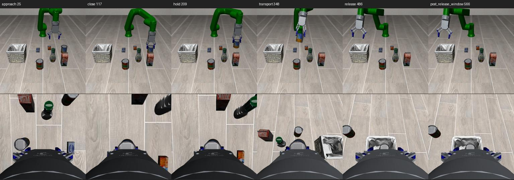

# ECO65＋ZhiXing 单任务试采完成记录

日期：2026-10-03。服务器工作目录：`/mnt/data/vla-policy/openpi/agent-work-space/2-task-collection`。

## 结论

**单任务试采链路已实现并验证：五次新种子尝试，五条任务成功，五条通过数据审计。** 本次选择 LIBERO Object task 0「抓起 alphabet soup 罐并放入篮子」，沿用已验证的 r20 专家及隔离控制配置。未修改上游夹爪、机器人资产、OSC参数或生产默认控制器。

这是仿真原始数据采集的阶段成果；没有进行π0.5训练，也不代表Spatial十任务、高成功率策略或实机适配已验收。

## 结果与数据

批次：`runs/pilot_53100_53104_r1/`。五个种子预先列入批次协议，未替换失败或补抽。旧验证种子52100的参考回归单列在`runs/reference_capture_r1/`，不计入本批分母。

| 种子 | 动作数 | 原任务及物理门限 | 动作回放 | 数据审计 |
|---|---:|---|---|---|
| 53100 | 576 | 通过 | 通过 | 接受 |
| 53101 | 574 | 通过 | 通过 | 接受 |
| 53102 | 576 | 通过 | 通过 | 接受 |
| 53103 | 580 | 通过 | 通过 | 接受 |
| 53104 | 575 | 通过 | 通过 | 接受 |

合计2,881条动作/观测配对、2,886个双视角观测，模拟示范时长144.05秒。五个HDF5文件合计600,615,810字节（约573 MiB）；CPU单条采集约212–221秒，不含后续回放审计。

- 两个相机：agentview、robot0_eye_in_hand；256×256 RGB uint8，20Hz；图像遵循现有推理预处理方向。
- 模型状态：8维（TCP位置3、轴角3、按名字取左右主动夹爪关节2）；同时保存完整qpos/qvel、夹爪6关节和内部目标。
- 实际动作：7维归一化OSC，原样保存；第t个观测对应第t个动作，并保留第t+1个动作后观测。
- reset状态及120步准备动作单独保存；示范从静置后的真实状态开始，避免旧观测与新动作错配。
- 保存语言、运行XML、阶段、原生任务标志、逐物理步受力/接触、脚本指纹、真实进程退出码及失败留档机制。

正式数据清单见[dataset_manifest.json](runs/pilot_53100_53104_r1/dataset_manifest.json)，大小及位置覆盖统计见[collection_stats.json](runs/pilot_53100_53104_r1/collection_stats.json)。每条HDF5在对应`can_s<seed>/trajectory.h5`；原始大文件保留在服务器。

## 验证依据

1. **记录器回归。** 同原验证种子52100比较，均为570步，阶段及原任务门限一致。动作最大差约4.33×10⁻⁷，qpos最大差约2.65×10⁻⁸；不是逐位相等，不将它表述为完全一致的旧实验复现。
2. **真实动作回放。** 每条从reset(seed)开始，执行保存的准备动作与示范动作，不注入轨迹qpos。五条全部状态、速度、模型状态、时间及原生成功标志与各自采集记录完全一致。每条抽查5个时刻、两个相机，像素最大误差为0；没有宣称逐像素检查全部图像帧。
3. **原物理判据。** 原样复用r6审计器，不放宽门限。本批共核对72,025个教师执行阶段物理步；2秒保持阶段双侧接触比例全部100%，最大指接触穿透约0.308mm，最大单步TCP位移约7.039mm，横向搬运最低净空约35.782mm。全部满足原门限，包含释放后20步稳定原生任务条件。
4. **时序与字段。** 核对T个动作与T+1个观测、动作前后qpos、20Hz时间、真实执行动作、阶段一致性、具名夹爪状态、数值有限性与双相机非空。任务成功和数据接受分别记录。
5. **拒收测试。** 六种故障均被拒收：过期观测、错误动作、错误夹爪状态、黑图、采集退出139、回放失败。见参考批次`negative_tests.json`。
6. **进程与输出保护。** 五次采集及五次回放均正常退出；最终启动器预检也正常退出。重复批次名被拒绝，已有HDF5哈希不变，见参考批次`entrypoint_test.json`。未使用强制退出掩盖历史内存异常。

## 实现与版本

当前实现：`versions/pilot_20261003_r1/`。运行方式、读取示例见[版本README](versions/pilot_20261003_r1/README.md)，数据协议见[单任务试采方案](versions/pilot_20261003_r1/单任务试采方案.md)。

上游目录清理后缺失的三个基础模块，从本机镜像恢复到新版本`vendor/`，SHA256与原成功记录逐项一致；其余专家及审计依赖从服务器原样复制。没有覆盖上游冻结文件。隔离运行时继续使用`1.3-zhixing_gripper_solve/runtime/py310_mj326`。

初始化使用legacy，静置120步后切换已有`eco65_no_extra_pd`；夹爪speed=0.01。生产默认控制配置未切换。后续推理必须明确对齐这套运行契约，不能只迁移权重。

冻结包：`releases/pilot_20261003_r1/`，20个新版本源码/文档/依赖文件已归档；连同选定后缀的robosuite/LIBERO源码与资产共核验1,367项指纹。归档20个成员与清单逐项一致。任务BDDL另存`task_definition/`补充快照，注明采集期间取得，不在主源码清单的后缀范围内。文件冻结和数据验收是两项不同结果。

开发预检中的容器挂载失败（退出125）保留在`runs/render_probe_r1/`；路径修正后的预检正常。随后处理了容器输出归属问题，当前入口为`pipeline.py`→`run_r3.py`。这些基础设施预检不计入五次任务统计。

## 尚未完成及下一步

**这批数据不具备充分的位置覆盖。** 五个完整场景状态哈希不同，但罐的初始中心在1mm精度下只有1个位置，浮点包围盒去重得到4个并不代表4个抓取位置。不能据此声称模型已具备抓取位置泛化。

腕部图像存在夹爪遮挡，本次保留相机配置。原碗任务的初始化及接近问题也未在此任务中修复；上游罐10/10、碗8/10的边界保持原状。

下一阶段建议：先制定可审计的场景覆盖与train/val/test划分，扩展至20–50条有效单任务示范；随后生成与当前项目版本一致的LeRobot数据、只用训练集计算归一化统计，并做小数据微调与闭环验证。同步核对推理端相机预处理、具名夹爪状态、20Hz控制及运行profile。之后再扩展到Spatial碗任务及其他任务。当前未启动训练、全量采集或实机部署。
