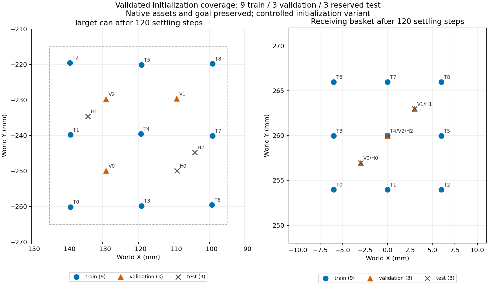

# 单任务场景覆盖完成记录

日期：2026-10-03。源码版本：`coverage_20261003_r1`。正式批次：`coverage_train_val_r1`。

ECO65＋ZhiXing的LIBERO Object罐入篮任务已完成一轮受控场景扩展：预登记12次正式采集，12次任务成功、12条数据审计通过。训练集9条、验证集3条；另外3个测试场景仅做初始化检查，未采集教师轨迹。共6,947个动作、6,959个观测，原始HDF5共1,448,724,395字节（约1.35 GiB）。

这是脚本专家的单任务采集结果，尚未训练或评估π0.5，也不代表Spatial十任务或机械臂整体适配验收。

## 为什么需要新版本

上一批5条示范的目标初态在毫米精度下基本相同。原任务目标采样区域宽度为50mm，采样器从两边各扣除资产声明的25mm横向半径后，XY区间均退化为单点。更换seed只能改变其他对象和微小浮点状态，不能扩大目标空间覆盖。

详见[场景采样退化问题记录](场景采样退化_问题记录_20261003_r1.md)。原冻结版本`pilot_20261003_r1`、原生BDDL和控制器保持原样；本次在独立新版本的reset采样返回阶段设置场景初态。示范执行期间没有写入物体/机械臂qpos，没有改变物体碰撞形状，也没有添加焊接约束。

该方案按物体中心定义位置，完整轮廓可超出原小采样区域。因此数据明确标为**受控初始化采集变体**，不能作为原始LIBERO分布成绩。

## 覆盖内容与数据划分

| 项目 | 设置与实测 |
|---|---|
| 训练目标中心 | X：−140/−120/−100mm；Y：−260/−240/−220mm，共3×3网格 |
| 训练目标偏航 | 相对原生姿态的世界Z轴增量−20°、0°、+20°，与位置组合，共9场景；不是27种全组合 |
| 篮子中心 | 训练X：−6/0/+6mm；Y：254/260/266mm，共9种组合 |
| 验证目标中心 | 网格间位置，共3场景；偏航−10°、+10°、0° |
| 保留测试目标中心 | 与训练、验证目标中心不同，共3场景；未采集教师轨迹 |
| 实际位置覆盖 | 15个初始化场景均通过；15个目标中心在1mm精度下可区分，最小间距6.861mm |
| 正式采集覆盖 | 12条轨迹有12个毫米级可区分目标中心；XY跨度40.150/40.620mm |
| 偏航保留 | 15个场景静置后相对预设偏航最大误差约0.000212° |
| 初始化接触 | reset与120步静置阶段非支撑穿透实测为0；静置目标漂移均≤5mm |

位置使用物体body中心，不能与碰撞包围盒中心混用。篮子部分位置跨划分复用；划分隔离的是场景及目标位置，不宣称每个因素都完全隔离。其他物体仍按原生seed采样，相机、光照、材质和质量未随机化。

场景及划分在正式采集前冻结于[scenes.json](versions/coverage_20261003_r1/scenes.json)，SHA256：`01494c79cb53314a28f2b78e00a213f225636a569f6d1f176444cbc2e961cd93`。不按帧划分，不混入旧pilot数据。

图中测试点仅表示初始化通过，不表示测试任务成功率。

## 逐场景结果

目标XY为120步静置后实测，单位mm；偏航为登记的相对原生姿态增量。每个场景正式尝试1次，无失败替换或重试筛选。

| 场景 | seed | 实测目标XY | 偏航增量 | 动作数 | 任务及数据审计 |
|---|---:|---|---:|---:|---|
| train_00 | 55100 | -139.074, -260.104 | -20° | 580 | 通过 |
| train_01 | 55101 | -139.094, -239.781 | +0° | 568 | 通过 |
| train_02 | 55102 | -139.224, -219.485 | +20° | 559 | 通过 |
| train_03 | 55103 | -119.094, -259.781 | +0° | 590 | 通过 |
| train_04 | 55104 | -119.224, -239.485 | +20° | 578 | 通过 |
| train_05 | 55105 | -119.074, -220.104 | -20° | 567 | 通过 |
| train_06 | 55106 | -99.224, -259.485 | +20° | 611 | 通过 |
| train_07 | 55107 | -99.074, -240.104 | -20° | 593 | 通过 |
| train_08 | 55108 | -99.094, -219.781 | +0° | 580 | 通过 |
| validation_00 | 55200 | -129.070, -249.942 | -10° | 577 | 通过 |
| validation_01 | 55201 | -109.146, -229.627 | +10° | 578 | 通过 |
| validation_02 | 55202 | -129.094, -229.781 | +0° | 566 | 通过 |

训练seed为55100—55108，验证seed为55200—55202；保留测试seed为55300—55302。初始化预检与两条无图像专家角点探针属于开发检查，不计入以上12次分母。

## 验证证据

- 12次采集、12次独立回放和最终审计进程均以0正常退出；每条原r6物理审计和数据审计均通过。
- 独立回放重新reset同一scene，再执行记录的120步准备动作和全部教师动作，没有注入保存的轨迹状态。全部观测时刻的qpos、qvel、state、时间及原生成功标记一致；每条抽检5个时刻、两路相机，RGB逐像素误差为0。不是全帧图像逐像素回放检查。
- 保留20Hz、7维真实执行OSC动作、8维具名state、双256×256 RGB和T动作/T+1观测契约；前后观测、时间、动作与教师日志对齐。
- 物理证据：所有轨迹持物阶段双侧接触占比100%；全批最大穿透0.730325mm，最大单步位移7.529082mm，最小水平搬运净空35.711210mm；不安全接触样本和机械臂接触非目标物体样本均为0。判定门限沿用原专家与r6审计，没有为通过而放宽。
- 6项原数据拒收测试全部通过：滞后观测、动作篡改、夹爪状态错配、空白RGB、采集崩溃、回放失败。新增4项场景拒收测试全部通过：场景split篡改、清单哈希篡改、初始化穿透超限、静置目标漂移超限；逐项检查对应错误原因。
- 入口拒绝采集test场景，未产生测试批次；正式训练与验证清单无seed交集，保留测试轨迹数为0。
- 完成后核对旧版1,367项、新版1,505项源码/依赖指纹及源码归档，全部通过。源码冻结与任务验收分别记录。
- 已人工查看训练首条与验证末条的双相机阶段预览，以及实际位置覆盖图。

汇总见[summary.json](reports/coverage_20261003_r1/summary.json)，每条审计、回放、预览见`runs/coverage_train_val_r1/can_s*/`。拒收测试及源码核对见`reports/coverage_20261003_r1/`。

## 文件与复现

服务器工作根目录：`/mnt/data/vla-policy/openpi/agent-work-space/2-task-collection`。

- 正式清单：[dataset_manifest.json](runs/coverage_train_val_r1/dataset_manifest.json)。
- 训练清单：[train_manifest.json](runs/coverage_train_val_r1/train_manifest.json)；验证清单：[validation_manifest.json](runs/coverage_train_val_r1/validation_manifest.json)。清单中的`/app/`是容器挂载路径，对应服务器仓库根目录。
- 原始轨迹：`runs/coverage_train_val_r1/can_s{seed}/trajectory.h5`，大文件及完整物理逐步日志仅保留在服务器；本机同步源码、清单、审计和图像证据。
- 当前入口与数据读取说明：[版本README](versions/coverage_20261003_r1/README.md)。新增批次必须使用全新目录名；禁止覆盖本次数据。
- 后续改变场景表、控制器、采集行为或审核规则，须建立新版本。本版旧辅助run脚本不作为覆盖采集入口。

## 下一阶段建议

先完成LeRobot转换及逐字段抽检，保持episode级train/validation划分，再做小数据过拟合与闭环策略验证。9条训练示范只是链路样本量，不足以证明高成功率；根据策略失败类型决定扩充位置、偏航组合或其他任务。保留测试场景不得用于专家筛选或训练调参。最终验收仍按已约定的Spatial十任务×20次独立测试、总体≥90%及Panda对照另行实施。
