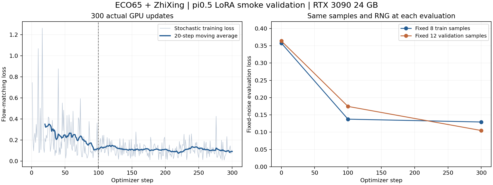
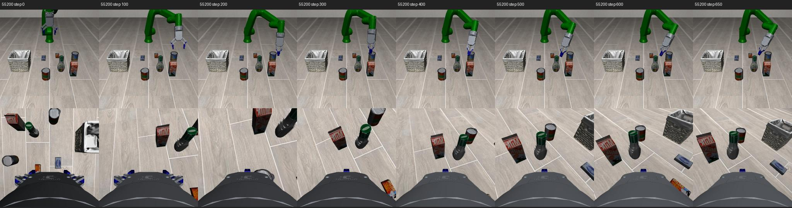

# 小数据 LoRA 微调验证完成记录

日期：2026-10-04。服务器工作目录：`/mnt/data/vla-policy/openpi/agent-work-space/3-lora-validation`。

## 结论与范围

**π0.5 的小数据 LoRA 训练、检查点保存、独立进程重载与优化器续训已通过本轮验证。RTX 3090 24GB 可以运行本配置。** 原始重载测试曾失败；保留失败证据后，通过对齐训练和重载的 JAX 编译缓存修复，未放宽 1e-5 阈值。

本轮针对既有单任务试采数据：LIBERO Object 的 alphabet soup 罐入篮任务、ECO65＋ZhiXing。不是全部 LIBERO Spatial 的适配验收，也不能把 loss 下降解释为高成功率。本轮附加闭环结果为 **0/3**，当前检查点未达到任务成功要求。

## 数据、模型与冻结范围

| 项目 | 实际配置 |
|---|---|
| GPU / 内存 | RTX 3090，24576 MiB 显存；服务器系统内存约 31 GiB |
| 基础模型 | 本地缓存 `pi05_libero`，保留基础权重 |
| 数据 | `coverage_lerobot_r1`：train 9 条、5226 帧；validation 3 条、1721 帧 |
| 数据划分 | 55100—55108 用于训练；55200—55202 用于验证；55300—55302 保留未用 |
| 归一化 | 只使用 5226 个训练样本计算；验证、推理使用相同训练统计量 |
| 输入 | 双 RGB、TCP xyz/rotvec＋ZhiXing 两个指定关节角，共 8 维 state；任务文本 |
| 动作 | 原 7 维归一化 OSC 增量＋夹爪指令，不重复做 delta 转换 |
| LoRA | `gemma_2b_lora`＋`gemma_300m_lora`，只训练名字包含 lora 的参数 |
| 总参数 / 可训练参数 | 3,403,421,456 / 49,987,584，约 1.47% |
| 资源配置 | batch=1，action horizon=10（与原 pi05_libero 一致），workers=0，EMA 关闭；冻结参数 BF16 |
| 优化 | AdamW，梯度裁剪 1.0；峰值学习率 1e-4；seed=42 |
| 环境 | Python 3.11.9，JAX/JAXlib 0.5.3，Flax 0.10.2，Orbax 0.11.13 |

视觉编码器、输入输出层及其余非 LoRA 参数均冻结。这比官方示例的默认冻结范围更严格，适用于本次小数据链路验证；不宣称等同于全参数微调。实际数据通过生产 OpenPI 数据转换、归一化、224×224 图像预处理、tokenizer 和 padding，再进入原生训练步骤。

先对第一条训练轨迹中的 8 个预先固定样本训练 100 步；随后从 5226 帧中均匀随机抽样训练 200 步（实际覆盖 197 个不同起点）。这不是完整遍历训练集，更不是充分收敛训练。

## 验证结果

以下评估使用预登记的同一组 8 个训练样本、12 个验证样本，以及固定随机噪声，三次测量可直接比较；不是完整验证集 loss。

| 固定样本平均 loss | 训练前 | 第 100 步 | 第 300 步 |
|---|---:|---:|---:|
| 训练样本 8 个 | 0.357669 | 0.137600 | 0.129392 |
| 验证样本 12 个 | 0.363837 | 0.174458 | 0.104754 |

- 100 步过拟合检查下降 **61.53%**，通过预定 ≥20% 门槛。
- 第 300 步固定验证样本 loss 较基线下降 **71.21%**，仅作为有限样本的学习信号。
- 300 个真实更新的 loss、梯度均有限；梯度范数范围 0.01605—1.50201（记录的是裁剪前范数）。
- 20 个 LoRA 参数叶子发生变化；所有非 LoRA 参数的逐字节 SHA256 不变。
- 标准 OpenPI 检查点已保存；独立进程恢复后的全部参数与训练结束逐字节一致。
- 复用编译缓存后，固定输入、随机种子的推理最大误差 **0.0 ≤ 1e-5**；输出形状为内部 `(1,10,32)`，策略输出取实际 7 个动作维度。
- 优化器与步数恢复后，实际完成第 **301** 步；loss=0.089934、梯度范数=0.226266。该续训测试没有覆盖第 300 步检查点。



训练进程退出码 0，总耗时 **658.39 秒**（含加载、编译、评估、保存与推理）。首步含编译约 90.86 秒，其余更新中位数 **0.291 秒/步**。每 2 秒采样的整卡显存峰值 **8563 MiB（8.36 GiB）**；没有发生显存不足。该显存数字不适用于更大 batch、不同动作长度或全参数训练。

## 问题、定位和处理

### 容器解释器权限

首个准备尝试退出 127：强行指定容器普通用户时，镜像 Python 依赖的 `/root/.local/share/uv/python/...` 共享库不可读。正式冻结前改为镜像默认用户运行，基础项目与模型缓存只读挂载，输出限定在新建的本目录。后续准备阶段退出 0。原始失败日志和启动器备份保留在 `runs/smoke_train_r1_execution/`。

### 参数相同但独立重载输出不同

第一次 `reload.py` 验证先通过所有恢复参数的字节校验，再在推理一致性断言处失败：最大差异 **0.0029296875**。训练使用了持久编译缓存，原重载进程没有使用相同缓存。

新增并冻结 `reload_cache_20261004_r1` 启动器，保留原验证脚本、相同数据、模型权重、随机种子和 1e-5 阈值，只对齐 `JAX_COMPILATION_CACHE_DIR` 并开启编译日志。日志明确出现 `jit_predict` 的 **Persistent compilation cache hit**，之后误差为 **0.0**，续训也通过，进程退出 0（218.41 秒）。

这组对照把问题定位到跨进程重新编译的数值一致性，而非权重丢失。具体底层 GPU 内核差异未进一步测定；不声称任意 GPU、JAX 版本或冷编译环境都具有逐位一致性。部署与严格回归时应同时记录运行时、硬件和编译配置。

原失败保留为 `reload.log` / `reload.status.json`；修复验证为 `reload_cached.log` / `reload_cached.status.json`。没有删除失败，也没有把原始失败改写成通过。

检查点保存中曾出现较长设备到主机传输等待，采样调用栈已保留，最终正常完成。重载日志中的缺少可选 `metrics/metrics` 提示也保留；本任务训练指标写入独立 `metrics.jsonl`，实际参数、优化器和恢复推理均已验证。

## 检查点与复现

正式输出：

```text
runs/smoke_train_r2/checkpoint/300/
  params/       推理参数，包含基础参数与 LoRA
  train_state/  优化器与训练步数
  assets/       训练数据归一化
```

检查点在服务器约 5.4 GiB，保留在服务器；本地工作区同步代码、冻结包、日志、指标、校验及预览，不复制大模型与 JAX 编译缓存。

在服务器仓库根目录使用新的运行名称，避免覆盖已有证据：

```bash
python3 agent-work-space/3-lora-validation/versions/lora_20261004_r1/scripts/launch.py --run smoke_repeat_20261004 --phase prepare
python3 agent-work-space/3-lora-validation/versions/lora_20261004_r1/scripts/launch.py --run smoke_repeat_20261004 --phase train
python3 agent-work-space/3-lora-validation/versions/reload_cache_20261004_r1/run.py --run smoke_repeat_20261004
```

需要原采集数据、模型缓存及本机现有 Docker 镜像。镜像真实 ID 见 `container_images_20261004_r1.json`，不仅依赖可变 tag。脚本拒绝覆盖已有正式输出；改动配置应新建版本。

训练源码为 `lora_20261004_r1`；运行名为 `smoke_train_r2`，两者是不同概念。`protocol.json` 在准备阶段登记已有源码；完整训练文件在训练前另经 `training_started.json` 与 65 项冻结清单登记。不存在用后续文件覆盖已冻结版本的情况。

## 完整性与证据

- `input_integrity_20261004_r1.json`：22 个数据文件、15 个基础权重文件、准备阶段的 59 项源码指纹全部保持一致。
- `releases/lora_20261004_r1/manifest.json`：65 项源码/依赖及源码归档校验通过。
- `runs/smoke_train_r2/training_result.json`、`reload_result.json`：机器可读验收结果。
- `runs/smoke_train_r2/metrics.jsonl`、`evaluation_indices.json`、`params_before.json`、`params_after.json`：逐步指标、固定评估样本与参数变化证据。
- 所有采集、控制器、场景定义和原审核判定代码保持原冻结版本。

## 附加仿真闭环诊断

使用原验证场景 55200、55201、55202，各测试一次。复现原准备动作后，三次初态 qpos 误差均为 0，双 RGB 均与采集记录完全一致。接入真实 OpenPI Policy，加载第 300 步检查点及其训练归一化，每次输出 10 步动作、执行前 5 步后重规划；保持原 `eco65_no_extra_pd` 控制器，最多 650 步。策略通信仅在服务器本机回环地址进行。

| 验证 seed | 执行步数 | 原生成功出现 | 稳定释放入篮 | 目标中心最大升高* | 物理警告 |
|---|---:|---|---|---:|---|
| 55200 | 650 | 否 | 否 | 1.69 mm | 0 |
| 55201 | 650 | 否 | 否 | 4.20 mm | 0 |
| 55202 | 650 | 否 | 否 | 3.61 mm | 0 |

*相对第一个策略控制步后的目标中心高度，仅用于失败诊断。

**原生成功 0/3，稳定释放入篮 0/3。** 三个仿真进程、策略服务均正常退出，GPU 已释放。没有用重试替换失败结果。稳定释放诊断还要求罐与篮接触、无罐与夹爪接触、开夹爪命令、连续 20 步满足且中心漂移小于 5mm；这里没有发生原生成功，因此不涉及放宽成功口径。

动作裁剪分别发生在 361、365、378 帧，全部是第 7 维夹爪命令越过归一化边界；前 6 维平移/旋转均没有裁剪。原输出和执行动作均保存。控制步边界采样的最大相关物体穿透分别约 0.044、0.194、0.099mm；这不能替代原 r6 逐物理子步的完整物理审计。



第一个预览中策略靠近干扰物区域，未完成目标罐的抓起搬运。三场景目标中心最大升高均小于 5mm，也未出现原生成功。当前证据说明模型仍未学会可靠完成任务；不能仅凭本轮结果断言唯一原因是数据少、训练短或某个控制参数。本轮没有未微调基线的同场景对照，不能量化微调对闭环成功率的增减。

结果与预览：`rollouts/validation_r1/`。逐步原始动作、裁剪后的动作、原生目标和接触情况均保留；汇总见 `closed_loop_summary_20261004_r1.json`。

## 下一阶段建议与尚未通过项

1. 保留本轮作为训练链路基线，在相同初态和输入输出接口下增加未微调模型对照，先区分基础策略表现与微调后的变化。
2. 针对接近目标、闭合抓取和抬升阶段扩充当前单任务示范覆盖。新增轨迹继续通过原采集/物理审计，不用失败策略轨迹冒充专家示范。
3. 新建训练版本，开展更长的单任务 LoRA 训练，定期同时检查固定验证 loss 与仿真闭环；按验证表现选择 checkpoint，保留最终测试初态隔离。当前 200 步短程微调尚未遍历一轮数据。
4. 单任务闭环稳定后再扩展到 LIBERO Spatial。最终仍按已约定的 10 个任务各 20 次独立测试、总成功率 ≥90%，并保留 Panda 对照验收。

本次完成的是小数据训练/保存/重载/续训与仿真调用验证；**高成功率单任务适配、Spatial 全套适配和真实机械臂部署均未通过本轮验收。**

