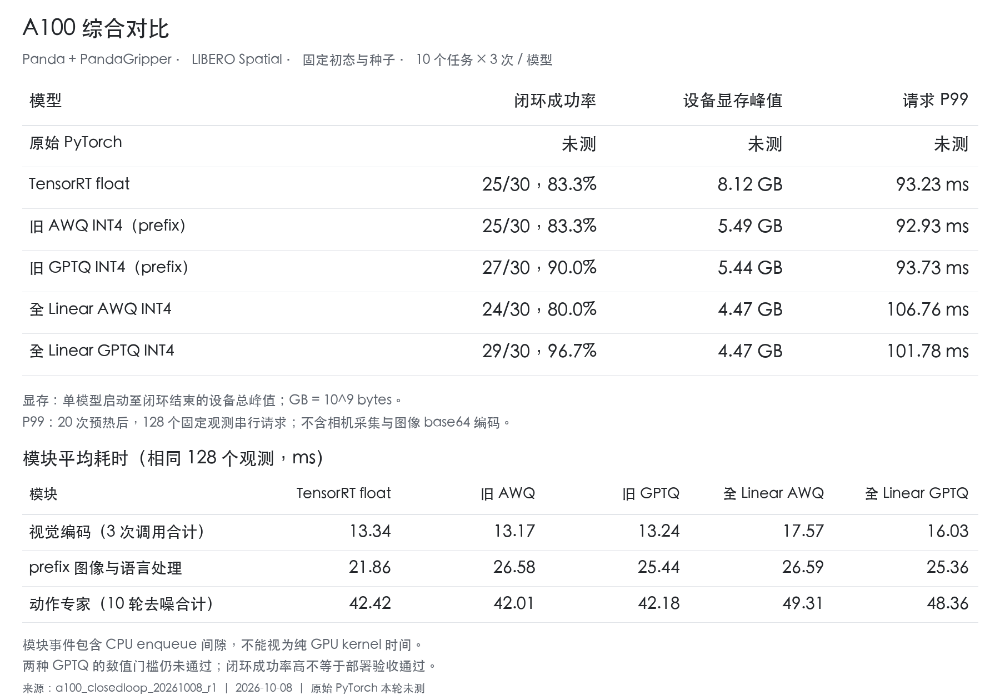

# A100 模型综合对比

日期：2026-10-08。依据冻结的 A100 五组统一测试重新整理，只进行数据汇总和制表，没有新增推理或修改模型、控制器及判定规则。

## 综合指标

| 模型 | 闭环成功率 | 设备显存峰值 | 请求 P99 |
|---|---:|---:|---:|
| 原始 PyTorch | 未测 | 未测 | 未测 |
| TensorRT float | 25/30，83.3% | 8.12 GB | 93.23 ms |
| 旧 AWQ INT4（prefix） | 25/30，83.3% | 5.49 GB | 92.93 ms |
| 旧 GPTQ INT4（prefix） | 27/30，90.0% | 5.44 GB | 93.73 ms |
| 全 Linear AWQ INT4 | 24/30，80.0% | 4.47 GB | 106.76 ms |
| 全 Linear GPTQ INT4 | 29/30，96.7% | 4.47 GB | 101.78 ms |

设备为 NVIDIA A100-SXM4-40GB。闭环采用 Panda+PandaGripper、LIBERO Spatial，每组 10 个任务各 3 个相同初态和种子。原始 PyTorch 在本轮 A100 未测试；图示中的原始 PyTorch 80% 和 241.86 ms 来自旧 4090 实验，不填入 A100 表。

设备显存是 NVML 记录的整卡总峰值，包含加载、预热、128 观测回归和闭环；不同于模型进程显存。GB 按 10^9 bytes 计。

请求 P99 来自 20 次预热后的 128 个相同观测串行请求，包含 JSON 请求构造、HTTP、服务端解码、预处理、完整三模块与 10 轮去噪、反归一化及响应解码。不含图像 base64 编码、相机采集、OSMesa 渲染；不是旧图中的 1000 请求基准，也不是主闭环双客户端排队时间。

## 模块平均耗时

| 模块（ms） | TensorRT float | 旧 AWQ | 旧 GPTQ | 全 Linear AWQ | 全 Linear GPTQ |
|---|---:|---:|---:|---:|---:|
| 视觉编码，3 次调用合计 | 13.34 | 13.17 | 13.24 | 17.57 | 16.03 |
| prefix 图像与语言处理 | 21.86 | 26.58 | 25.44 | 26.59 | 25.36 |
| 动作专家，10 轮去噪合计 | 42.42 | 42.01 | 42.18 | 49.31 | 48.36 |

模块值从与请求 P99 相同的 128 个观测逐请求记录求算术平均，没有用闭环分化后的输入混算。CUDA 事件区间含 CPU enqueue 间隙，不是纯 GPU kernel 时间。分模块均值相加也不能等同于端到端 P99。

## 全量化相对旧量化

| 模型 | 成功数变化 | 设备峰值变化 | 请求 P99 变化 |
|---|---:|---:|---:|
| 全 Linear AWQ INT4 相对 旧 AWQ INT4（prefix） | -1 集 | -18.5% | +14.9% |
| 全 Linear GPTQ INT4 相对 旧 GPTQ INT4（prefix） | +2 集 | -17.8% | +8.6% |

本轮全 Linear 量化降低设备显存峰值，但固定观测请求 P99 增加。全 AWQ 少成功 1 集，全 GPTQ 多成功 2 集；每组仅 30 集，不据此认定算法普遍优劣。

**两种 GPTQ 的数值门槛均未通过**。全 GPTQ 29/30 不能替代数值验收；AWQ 的闭环成功率也未达到 27/30。本轮没有模型同时通过闭环与两组数值门槛，20 Hz / 实机部署未验收。

[表格图片](A100综合对比表.png)、[机器可读数据与来源 SHA256](comparison.json)、[原始测试记录](../a100_closedloop_20261008_r1/A100统一闭环测试记录.md)。

