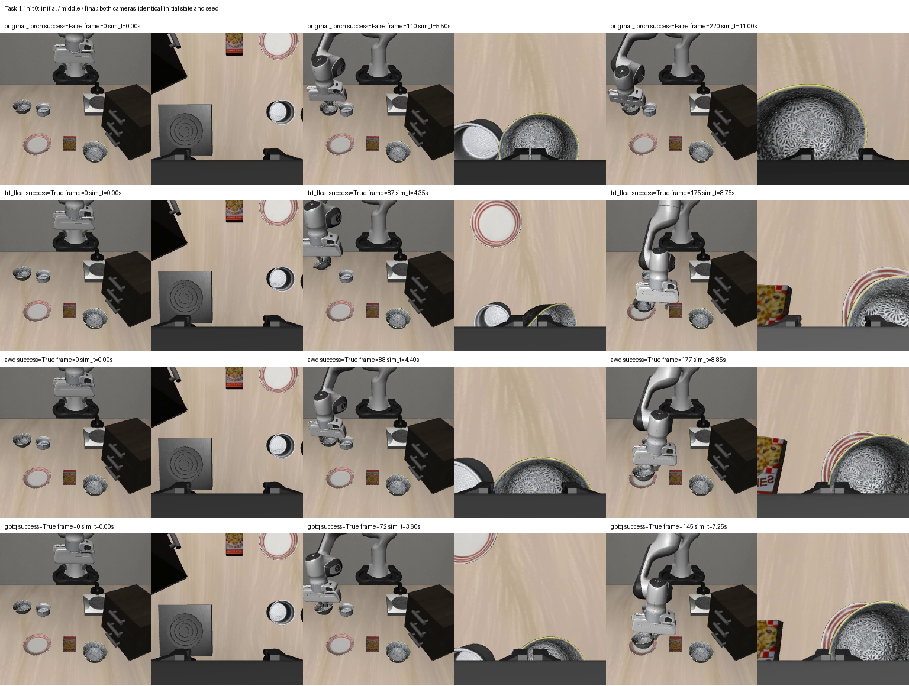
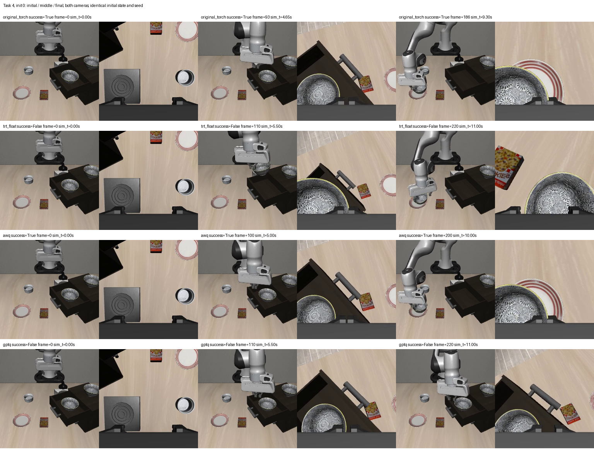

# T4 闭环与资源对比记录

日期：2026-10-07。版本：`trt_t4_20261007_r1`。服务器工作目录：`/mnt/data/vla-policy/openpi/agent-work-space/6-model-inference`。

## 结论与真实验收状态

本轮已完成 Panda+PandaGripper 的四组 LIBERO Spatial 闭环，共 120 集；四组各完成 1,000 次连续推理及独立的单客户端延迟探针。原有 T0–T3 模型、engine、校准数据、日志与失败项均保留，没有重新量化、微调模型或改动控制器。

**AWQ 的同输入数值检查和当前设备资源稳定性筛查通过，闭环为 26/30，与同环境 TensorRT float 相同；但未达到既定 ≥27/30 门槛，T4 质量候选不合格。** GPTQ 为 25/30，旧 T3 夹爪方向分歧未通过项继续保留。原始 PyTorch 与 float 本身也低于 27/30，不能把当前全部失败归因于 INT4。

| 模型 | 实际成功 | 成功率 | 相对 TRT float 丢失 / 恢复 / 净损失（集） | ≥27/30 且净损失≤1 |
|---|---|---|---|---|
| 原始 PyTorch | 24/30 | 80.00% | 3 / 1 / 2 | 未通过 |
| TensorRT float | 26/30 | 86.67% | 0 / 0 / 0 | 未通过 |
| TensorRT AWQ INT4 | 26/30 | 86.67% | 2 / 2 / 0 | 未通过 |
| TensorRT GPTQ INT4 | 25/30 | 83.33% | 2 / 1 / 1 | 未通过 |

AWQ 新增失败为 `(task2, init2)`、`(task5, init2)`，恢复为 `(task2, init0)`、`(task4, init0)`；净损失 0，并非逐集结果完全相同。GPTQ 新增失败为 `(task2, init2)`、`(task5, init2)`，恢复为 `(task4, init2)`；净损失 1，但绝对成功数和旧离线门槛仍未通过。

每组只有 30 集，是预先登记的开发测试；成功率与 Wilson 描述区间见原始报告，不将有限样本的差异解释为显著提升，也不据此宣称实机高成功率。冻结文件仅意味着证据可追溯，不表示部署验收通过。

## 对照与执行条件

原始组使用同源官方 `pi05_libero` BF16 权重值和原 PyTorch 采样实现；没有加载 ECO65/ZhiXing 微调权重，**没有测量原 JAX 后端性能**。float、AWQ、GPTQ 均复用冻结 T3 bundle 与运行时，模型环境为 PyTorch 2.7.1+cu126、TensorRT 10.13.3.9、ModelOpt 0.33.1。模型容器镜像固定为 `sha256:cf96556ab8b55eb3f80770d2a684d6961c0128c8100660a8cc4c7e61ecc60369`。

仿真镜像固定为 `sha256:1ac69906b0b877c9fe1c2964794aa5b90112850da01967a445658e41a958f284`，Python 3.10.12、MuJoCo 3.2.6、robosuite 1.4.1，OSMesa 软件渲染。每个 CPU 仿真容器固定 2 CPU / 3 GB，一次只驻留一个 GPU 模型，主闭环最多两个仿真客户端；资源测试为串行单客户端。

固定执行契约：Panda/PandaGripper（运行类为 MountedPanda），原 OperationalSpaceController，`kp=[150]*6`，平移输出范围 ±0.05 m、旋转输出范围 ±0.5 rad，20 Hz 仿真控制。先等待 10 步，最多执行 220 策略步；每次采样 10 个环境动作、执行前 5 个再重规划，10 次去噪。双相机输入按既有链路翻转两轴、缩放填充到 224；state 为末端位置、轴角与两指位置。收到的动作按原参考转 FP32，记录未裁剪值，再 `np.clip(action,-1,1)` 执行，成功仍由环境 `_check_success()` 判定。

10 个任务各用官方初态索引 0、1、2。种子为 `940000+100*task+init_index`，重规划噪声为 `episode_seed*1000+replan_index`。这些初态与旧校准登记分离；最后 20 个正式初态（30–49）未使用。四组每个对应场景的完整 settled 仿真状态、首帧 RGB/state、XML、控制器 SHA256 全部相同，120 集无不匹配。

登记证据：[场景与种子](../../runs/trt_t4_20261007_r1/preflight_r1/scenes.json)、[控制器](../../runs/trt_t4_20261007_r1/preflight_r1/controller.json)、[仿真环境源码指纹](../../runs/trt_t4_20261007_r1/preflight_r1/environment.json)、[T3 依赖核对](../../runs/trt_t4_20261007_r1/dependencies_r1/verified.json)、[协议](protocol.json)。所有任务容器真实退出码为 0；12 个模型服务（资源、闭环、延迟各四组）正常关闭。

## 分任务成功率

任务编号从 0 开始，每项分母固定为 3，没有筛除失败或把延迟探针算入成功率。

| task | 指令简写 | 原始 PyTorch | TRT float | AWQ | GPTQ |
|---|---|---|---|---|---|
| 0 | 黑碗盘子与小碗之间 → 盘子 | 3/3 | 3/3 | 3/3 | 3/3 |
| 1 | 黑碗小碗旁 → 盘子 | 2/3 | 3/3 | 3/3 | 3/3 |
| 2 | 黑碗桌面中央 → 盘子 | 1/3 | 2/3 | 2/3 | 1/3 |
| 3 | 黑碗饼干盒上 → 盘子 | 3/3 | 3/3 | 3/3 | 3/3 |
| 4 | 黑碗木柜上层抽屉内 → 盘子 | 1/3 | 0/3 | 1/3 | 1/3 |
| 5 | 黑碗小碗上 → 盘子 | 2/3 | 3/3 | 2/3 | 2/3 |
| 6 | 黑碗饼干盒旁 → 盘子 | 3/3 | 3/3 | 3/3 | 3/3 |
| 7 | 黑碗炉灶上 → 盘子 | 3/3 | 3/3 | 3/3 | 3/3 |
| 8 | 黑碗盘子旁 → 盘子 | 3/3 | 3/3 | 3/3 | 3/3 |
| 9 | 黑碗木柜上 → 盘子 | 3/3 | 3/3 | 3/3 | 3/3 |

主要失败集中在 task2、task4、task5。task4 的 float 为 0/3，原始/AWQ/GPTQ 各 1/3；这显示基线及转换后的闭环本身还需要诊断。接触、夹持、放置与成功触发对动作轨迹敏感；即使初态相同，微小输出变化也可能形成不同后续观测。现有证据支持轨迹敏感这一解释，尚不能唯一定位到某个算子或夹爪数值边界。

两个固定差异案例的原视频抽帧供审阅，三列为各自初始／中间／最终，时间按仿真控制步计算。它们仅是可视化示例，不改变测试分母：

## 完整单模型资源与稳定性

当前设备为显存容量 49,140 MiB 的开发端 RTX 4090，未人为施加 8 GB 硬上限。所有组使用相同当前设备与镜像，按顺序运行，GPU 无其他计算 PID。宿主 NVML 从容器启动前开始每 20 ms 采样，覆盖导入、加载、预热、运行及关闭；同时记录设备总用量与模型进程用量。表中 GB 为十进制 `10^9 bytes`，不是 GiB。

每组先做 20 次暖请求，再循环使用旧 128 个真实观测完成 1,000 次串行请求。HTTP 延迟包含本地传输、解码、预处理、完整三模块／10 次去噪、反归一化与返回；图像已经捕获，**不含真实相机采集与仿真渲染**。model path 列为服务内完整模型路径；所有计时均包含本轮 instrumentation。

| 模型 | 模型进程峰值 GB | 设备总峰值 GB | HTTP P50 ms | HTTP P99 ms | model path P99 ms | 1,000 请求时长 s |
|---|---|---|---|---|---|---|
| 原始 PyTorch | 7.726 | 8.265 | 203.00 | 241.86 | 238.22 | 207.64 |
| TensorRT float | 7.395 | 7.933 | 81.88 | 86.84 | 83.43 | 82.68 |
| TensorRT AWQ INT4 | 4.626 | 5.165 | 84.13 | 90.26 | 86.72 | 85.09 |
| TensorRT GPTQ INT4 | 4.618 | 5.157 | 83.62 | 88.92 | 85.55 | 84.40 |

AWQ/GPTQ 满足本轮进程 ≤6.4 GB、设备 ≤7.2 GB 的预算筛查；原始与 float 均不满足这些预留预算。4090 上能运行不代表 8 GB 目标设备已验收。prefix、vision、action_step 三个模块均完整装载，未通过 CPU offload、只测 prefix 或同时装载多套模型来替代完整路径。

全部 4,000 次正式资源请求输出有限、无 OOM；早／晚十分位进程峰值差为 0 bytes（本轮增长门槛 64 MiB）。前 128 个观测重放相对冻结结果最大差均为 0，连续 1,000 次后重复第一观测最大差也为 0。这是本轮有限时长稳定性筛查；**未完成两小时连续运行**。

| 模型 | vision 合计均值 ms | prefix 均值 ms | 10 次 action_step 合计均值 ms |
|---|---|---|---|
| 原始 PyTorch | 22.91 | 32.69 | 140.96 |
| TensorRT float | 10.27 | 26.77 | 36.50 |
| TensorRT AWQ INT4 | 10.31 | 28.68 | 36.57 |
| TensorRT GPTQ INT4 | 10.30 | 28.25 | 36.53 |

相对 TRT float，AWQ 的模型进程峰值降低约 37.4%，设备峰值降低约 34.9%，但 HTTP P99 从 86.84 ms 到 90.26 ms，当前实现没有测出 INT4 比 float 更快。prefix 均值也从 26.77 ms 到 28.68 ms；T3 记录的路径包含 INT4 权重反量化／BF16 GEMM，vision 与动作专家仍保留浮点计算，不能把文件压缩等同于全模型整数运算加速。相对原始 PyTorch 的加速包含 TensorRT 后端变化，不等同于仅量化带来的收益。

详见各组 `resource_<variant>_r1/benchmark/summary.json`、`memory_summary.json`，宿主原始采样为 `resource_<variant>_r1_memory.jsonl`。[AWQ 资源请求](../../runs/trt_t4_20261007_r1/resource_awq_r1/benchmark/summary.json)、[AWQ 生命周期显存](../../runs/trt_t4_20261007_r1/resource_awq_r1/memory_summary.json)。

## 包含仿真渲染的延迟

主闭环有两个 CPU 客户端，因此另做四次单客户端 task0/init0 复测，固定初态和种子，复测成功与原场景一致，四集不加入质量分母。相机到动作计时从上一仿真步开始，到下一次推理返回，包含该步物理仿真／软件渲染、视频记录和请求链路，不能称为真实机器人曝光到控制周期。

| 模型 | 主闭环两客户端 P99 ms | 单客户端重规划次数 | 首次重规划 ms | 单客户端全部 P99 ms | 单客户端稳态 P50 ms | 单客户端稳态 P99 ms |
|---|---|---|---|---|---|---|
| 原始 PyTorch | 711.54 | 17 | 713.25 | 682.71 | 498.63 | 520.54 |
| TensorRT float | 522.25 | 17 | 565.97 | 542.11 | 375.33 | 414.36 |
| TensorRT AWQ INT4 | 499.76 | 18 | 616.84 | 579.79 | 379.10 | 398.02 |
| TensorRT GPTQ INT4 | 534.87 | 18 | 585.49 | 552.01 | 380.41 | 388.28 |

四组均未通过相机到动作 P99≤200 ms 门槛。第一次重规划含初态文件审计和视频初始化，单独列出；稳态列去掉首次，仅用于描述，不替换原门槛或删掉慢请求。每次单客户端仅 17–18 个重规划，不能把小样本 P99 当成生产稳定性保证。

当前环境每仿真步／OSMesa 渲染约 290 ms，是这条链路的主要耗时。AWQ 模型单请求约 90 ms，而单客户端稳态相机到动作 P99 约 398 ms：模型与渲染分别需要优化／验证，不能由 90 ms 推断相机链路已满足 200 ms。20 Hz 视频是仿真时间播放速度，并非主机能达到实时 20 Hz；这些测试也未验证硬件相机、控制传输或实机推理期间机器人持续运动的效果。

## 同输入数值检查与未通过项

旧 pilot 128 观测、以及新的 30 个相同初态首观测分别对比，后者每个观测计入完整 10 步 action chunk，共 300 个夹爪值。后续闭环轨迹已分化，输入不相同，其动作差只用于轨迹分析，不被算作同输入量化误差。

沿用原定义：motion 差为 `abs(candidate-reference)/2`，MAE≤0.01、P99≤0.05；参考夹爪 `abs(g)>0.2` 时方向分歧≤0.5%；全部七维未裁剪动作的越界率增量≤1 个百分点。表中越界增量单位为百分点，未扩大原阈值。

| 候选 | 同输入数据／参考 | motion MAE | motion P99 | 夹爪方向分歧 | 越界增量 pp | 数值门槛 |
|---|---|---|---|---|---|---|
| AWQ | 旧 128 观测，相对 TRT float | 0.002899 | 0.022642 | 6/1280 | -0.223214 | 通过 |
| AWQ | 旧 128 观测，累计相对原 PyTorch | 0.002932 | 0.023297 | 6/1280 | +0.892857 | 通过 |
| AWQ | 新 30 初始观测，相对 TRT float | 0.002554 | 0.015561 | 0/300 | -0.095238 | 通过 |
| AWQ | 新 30 初始观测，累计相对原 PyTorch | 0.002545 | 0.016068 | 0/300 | +0.904762 | 通过 |
| GPTQ | 旧 128 观测，相对 TRT float | 0.004878 | 0.037819 | 7/1280 | -1.651786 | 未通过 |
| GPTQ | 旧 128 观测，累计相对原 PyTorch | 0.004885 | 0.037442 | 7/1280 | -0.535714 | 未通过 |
| GPTQ | 新 30 初始观测，相对 TRT float | 0.004153 | 0.023209 | 0/300 | -3.047619 | 通过 |
| GPTQ | 新 30 初始观测，累计相对原 PyTorch | 0.004168 | 0.023603 | 0/300 | -2.047619 | 通过 |

AWQ 两个数据集相对 TRT float 和累计相对原 PyTorch 均通过；新初态夹爪分歧 0/300 不表示旧 T3 的 6/1280 被删除。GPTQ 新初态通过，但旧 7/1280=0.546875% 仍高于 0.5%，保持未通过。T1 float 相对原 PyTorch 的旧越界率增量 +1.116071 个百分点也仍未通过；此前用户临时允许推进，并未把它改判为通过。

## 证据位置、冻结与后续工作

汇总：[机器可读报告](../../runs/trt_t4_20261007_r1/report_r1/summary.json)、[120 集结果表](../../runs/trt_t4_20261007_r1/report_r1/episodes.csv)、[124 视频与初态／动作回读审核](../../runs/trt_t4_20261007_r1/artifact_audit_r1/verified.json)。全部 124 个视频已从头到尾解码，16,434 帧有效；每步原始动作与对应重规划 chunk 一致，执行动作符合原裁剪规则，失败集均完整执行到 220 步。

主闭环目录为 `runs/trt_t4_20261007_r1/closedloop_<variant>_r1/taskXX/`，每集保存 `initYY.json`（所有 10×7 原始 chunk、每步实际动作、成功标志与计时）、`initYY.mp4`（双相机）、`initYY_settled.npy`、`initYY_initialobs.npz`。四组延迟探针另在 `latency_<variant>_r1/episode/`。例如：[AWQ task4/init0 视频](../../runs/trt_t4_20261007_r1/closedloop_awq_r1/task04/init00.mp4)、[AWQ task2/init2 失败动作](../../runs/trt_t4_20261007_r1/closedloop_awq_r1/task02/init02.json)、[float 对应成功视频](../../runs/trt_t4_20261007_r1/closedloop_trt_float_r1/task02/init02.mp4)。

新 release：`releases/trt_t4_20261007_r1/manifest.json`，继承旧 T3 冻结依赖，完整服务器 SHA256 校验记录为 `server_verify_r1.json`。本地保留本轮完整小体量实验记录与视频；旧模型权重和 engine 仍仅在服务器，本地校验明确为部分镜像，不以缺少大文件的本地校验替代服务器完整校验。

状态分别记录：T4 实验已完成；AWQ 数值与当前设备有限稳定性通过；AWQ/GPTQ 闭环绝对成功率未通过；相机链路 200 ms 未通过。4070/8 GB、两小时、正式 200 次、实机均未执行。没有删除或覆盖任何冻结旧版本。

下一阶段优先在新版本诊断基线 task2/task4/task5 失败，核对夹持、接触与放置阶段和采样链路的轨迹差异，先使固定协议基线达到门槛；再讨论量化候选、目标设备新 engine 构建和真实单客户端相机链路。任何控制参数、采集行为或判定逻辑的调整须另建版本并明确登记，不在本轮静默更改。当前其他目录的数据采集／训练作业未改动。
