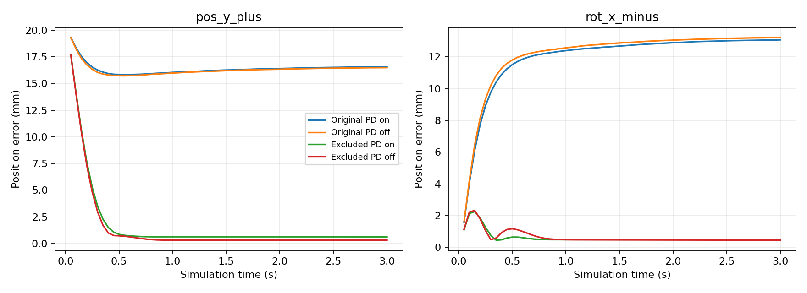

# 基座—第一连杆碰撞对消融

在 64 项基础验证发现持续自接触后，新增 16 项针对性验证。仅在测试环境 XML 中添加 robot0_base 与 robot0_link_1 的 contact/exclude；其他碰撞保留，仓库 robot.xml 未修改。所有 reset qpos 哈希一致。

|PD|测试|原始位置误差 mm|排除碰撞后 mm|原始姿态误差 °|排除后 °|
|---|---|---:|---:|---:|---:|
|开|hold|1.570|0.000|0.167|0.000|
|开|pos_y_plus|16.554|0.627|2.006|0.129|
|开|pos_y_minus|13.406|0.603|1.688|0.124|
|开|rot_x_minus|13.044|0.487|1.663|0.165|
|关|hold|1.550|0.000|0.166|0.000|
|关|pos_y_plus|16.473|0.315|2.031|0.076|
|关|pos_y_minus|13.399|0.416|1.716|0.091|
|关|rot_x_minus|13.195|0.458|1.611|0.090|

原始接触的最深穿透约 12.172 mm。接触力读取在首轮伴随原生内存错误，正式验证移除了该读取路径，不使用首轮接触力数值作结论。

碰撞排除后上述 8 项全部通过尾段 2 mm / 2° 筛查。这支持该碰撞约束是本轮方向性跟踪异常的主要原因；尚未验证全部工作空间和策略成功率。

