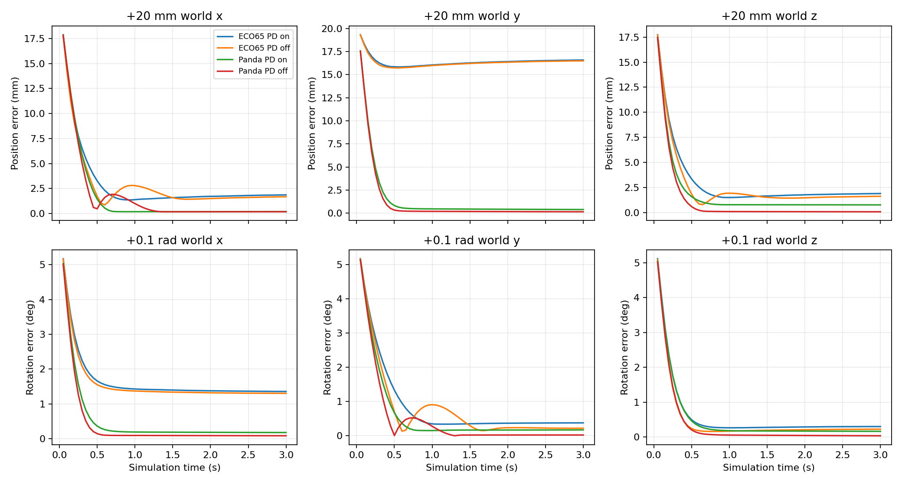
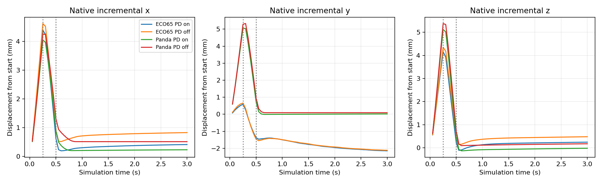

# ECO65 + Panda 夹爪：控制器验证结果

本轮为无模型、无渲染的 MuJoCo 仿真验证。固定 LIBERO spatial task0、seed=7、PandaGripper、20 Hz；Panda 为参考对照。未连接或控制实体机器人。

## 实验与可信性

- 四组：ECO65/Panda × 额外关节 PD 开/关，每组 16 个测试，共 64 个；另有 4 个冒烟测试。
- 固定目标：静止保持，以及世界坐标 x/y/z 的 ±2 cm 平移和 ±0.1 rad 旋转；每项 3 秒。目标为等待 10 步后的控制器 grip_site 位姿加偏移，并持续保持。
- 原生接口：x/y/z 各执行 +0.1 指令 5 步、-0.1 指令 5 步，再执行零动作至 3 秒；保留原生每步相对当前末端设置目标的语义。
- PD 关闭通过测试进程内将原控制函数的 joint_kp=3.0 改为 0.0 实现；原 OSC 零空间控制不变。源码文件不变。
- 每对 PD 开关实验的 reset 全部 qpos 哈希相同；每个控制子步均断言测量的限幅后力矩与执行器 ctrl 一致。
- 位姿从控制器使用的 grip_site 读取；相机不参与本实验。每个固定目标在每个策略步均核查未漂移。
- 筛查阈值：最后 0.5 秒平均位置误差 <2 mm 且姿态误差 <2°。这是本次工程筛查标准，非产品指标或任务成功率。

## 固定目标结果（每组 13 项）

| 机械臂 | 额外 PD | 通过数 | 最差尾段位置误差 mm | 最差尾段姿态误差 ° | 最大单关节饱和占比 |
|---|---|---:|---:|---:|---:|
| ECO65 | 开 | 6/13 | 16.554 | 2.006 | 0.67% |
| ECO65 | 关 | 9/13 | 16.473 | 2.031 | 0.73% |
| Panda | 开 | 13/13 | 0.849 | 0.176 | 0.47% |
| Panda | 关 | 13/13 | 0.454 | 0.082 | 0.47% |

## 全部测试明细

|机械臂|PD|测试|50ms位置误差 mm|250ms位置误差 mm|尾段位置误差 mm|尾段姿态误差 °|筛查|
|---|---|---|---:|---:|---:|---:|---|
|ECO65|开|hold|0.079|0.360|1.570|0.167|通过|
|ECO65|开|pos_x_plus|17.788|7.767|1.838|0.231|通过|
|ECO65|开|pos_x_minus|17.753|7.747|1.687|0.205|通过|
|ECO65|开|pos_y_plus|19.319|16.542|16.554|2.006|未通过|
|ECO65|开|pos_y_minus|19.124|15.815|13.406|1.688|未通过|
|ECO65|开|pos_z_plus|17.742|7.639|1.862|0.268|通过|
|ECO65|开|pos_z_minus|17.743|7.508|1.951|0.269|通过|
|ECO65|开|rot_x_plus|1.385|8.236|9.939|1.358|未通过|
|ECO65|开|rot_x_minus|1.566|8.916|13.044|1.663|未通过|
|ECO65|开|rot_y_plus|2.479|7.931|2.197|0.376|未通过|
|ECO65|开|rot_y_minus|2.498|8.260|2.249|0.363|未通过|
|ECO65|开|rot_z_plus|0.191|0.860|2.006|0.299|未通过|
|ECO65|开|rot_z_minus|0.150|0.629|1.338|0.189|通过|
|ECO65|开|native_x|4.437|4.045|0.008|0.066|不适用|
|ECO65|开|native_y|4.924|4.923|0.008|0.054|不适用|
|ECO65|开|native_z|4.444|4.114|0.008|0.069|不适用|
|ECO65|关|hold|0.064|0.356|1.550|0.166|通过|
|ECO65|关|pos_x_plus|17.741|7.266|1.649|0.171|通过|
|ECO65|关|pos_x_minus|17.700|7.265|1.423|0.161|通过|
|ECO65|关|pos_y_plus|19.289|16.337|16.473|2.031|未通过|
|ECO65|关|pos_y_minus|19.135|15.692|13.399|1.716|未通过|
|ECO65|关|pos_z_plus|17.712|7.104|1.585|0.178|通过|
|ECO65|关|pos_z_minus|17.713|6.955|1.546|0.180|通过|
|ECO65|关|rot_x_plus|1.453|8.686|10.110|1.304|未通过|
|ECO65|关|rot_x_minus|1.614|9.341|13.195|1.611|未通过|
|ECO65|关|rot_y_plus|2.508|7.394|1.680|0.221|通过|
|ECO65|关|rot_y_minus|2.527|7.771|1.577|0.190|通过|
|ECO65|关|rot_z_plus|0.178|0.837|1.928|0.222|通过|
|ECO65|关|rot_z_minus|0.150|0.623|1.224|0.153|通过|
|ECO65|关|native_x|4.425|3.979|0.008|0.062|不适用|
|ECO65|关|native_y|4.885|4.941|0.007|0.047|不适用|
|ECO65|关|native_z|4.436|4.047|0.008|0.065|不适用|
|Panda|开|hold|0.000|0.000|0.000|0.000|通过|
|Panda|开|pos_x_plus|17.883|7.569|0.194|0.008|通过|
|Panda|开|pos_x_minus|17.879|7.506|0.173|0.002|通过|
|Panda|开|pos_y_plus|17.563|4.881|0.407|0.081|通过|
|Panda|开|pos_y_minus|17.563|4.881|0.407|0.081|通过|
|Panda|开|pos_z_plus|17.473|5.140|0.755|0.142|通过|
|Panda|开|pos_z_minus|17.473|5.022|0.707|0.131|通过|
|Panda|开|rot_x_plus|1.590|1.270|0.468|0.176|通过|
|Panda|开|rot_x_minus|1.590|1.270|0.468|0.176|通过|
|Panda|开|rot_y_plus|2.575|6.286|0.808|0.170|通过|
|Panda|开|rot_y_minus|2.581|6.486|0.849|0.173|通过|
|Panda|开|rot_z_plus|0.649|0.995|0.412|0.164|通过|
|Panda|开|rot_z_minus|0.649|0.995|0.412|0.164|通过|
|Panda|开|native_x|4.484|4.062|0.001|0.010|不适用|
|Panda|开|native_y|4.409|3.832|0.000|0.021|不适用|
|Panda|开|native_z|4.382|3.862|0.002|0.027|不适用|
|Panda|关|hold|0.000|0.000|0.000|0.000|通过|
|Panda|关|pos_x_plus|17.833|7.013|0.177|0.034|通过|
|Panda|关|pos_x_minus|17.829|6.939|0.160|0.031|通过|
|Panda|关|pos_y_plus|17.526|4.274|0.162|0.028|通过|
|Panda|关|pos_y_minus|17.526|4.274|0.162|0.028|通过|
|Panda|关|pos_z_plus|17.440|4.466|0.066|0.007|通过|
|Panda|关|pos_z_minus|17.440|4.345|0.103|0.006|通过|
|Panda|关|rot_x_plus|1.630|0.538|0.454|0.082|通过|
|Panda|关|rot_x_minus|1.630|0.538|0.453|0.082|通过|
|Panda|关|rot_y_plus|2.600|5.166|0.158|0.023|通过|
|Panda|关|rot_y_minus|2.606|5.373|0.094|0.011|通过|
|Panda|关|rot_z_plus|0.630|0.262|0.034|0.037|通过|
|Panda|关|rot_z_minus|0.630|0.262|0.034|0.037|通过|
|Panda|关|native_x|4.472|3.991|0.000|0.000|不适用|
|Panda|关|native_y|4.401|3.754|0.000|0.007|不适用|
|Panda|关|native_z|4.374|3.779|0.002|0.025|不适用|

## 适用范围

- 原生零动作会重新设置位置目标，尾段误差小不能证明之前的运动量全部执行到位；需结合轨迹图判断。
- 测试仅覆盖单一场景、初始姿态附近的小范围运动，不能证明完整抓取路径可达，亦不能代替负载、接触或真实硬件验证。
- 同一机器人 PD 开关的 reset 一致，但等待 10 步后的锚点允许受 PD 影响；warmup_drift_mm 与 start_eef_pos 已保存。
- 雅可比最小奇异值混合米和弧度单位，仅作诊断线索，不能跨机器人直接作为统一奇异阈值。
- 原始关节力矩饱和、关节限位利用率、接触对计数见逐项 JSON；每 50ms 位姿见逐项 CSV。

