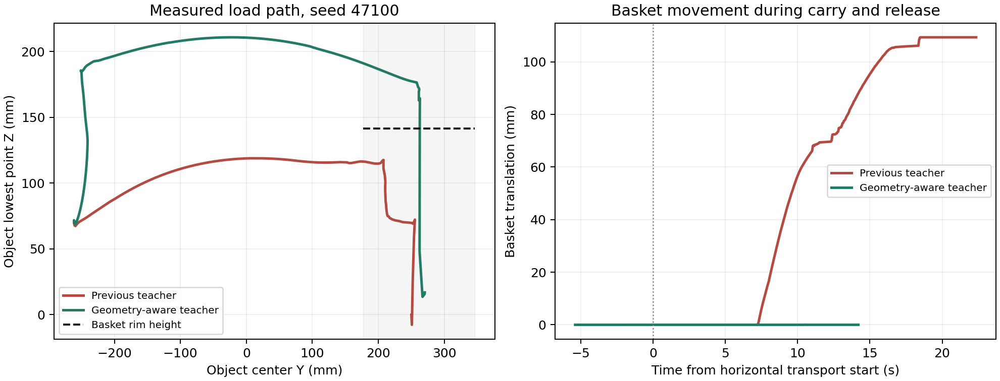

# ZhiXing 安全教师路径实现与验证记录 r1

日期：2026-10-02。专用目录：`/mnt/data/vla-policy/openpi/agent-work-space/zhixing_gripper_solve`。

## 当前结论

已实现并实测“按实际几何生成安全高度 → 垂直抬升到位 → 横向搬运到位 → 下降到释放高度 → 释放后稳定验证”的教师。

**最终教师 `safe_teacher_r8.py`：回归 5/5，锁定代码后新增初态 10/10。** 共15个独立进程正常退出，保存220,900个物理步接触样本。独立证据检查通过。

本结果限于 ECO65+ZhiXing、LIBERO Object task0 的60×30×70 mm、0.0882 kg诊断试块。它证明本轮试块教师可用；不代表真实碗/罐、Spatial 10任务×20次、图像采集或实机适配通过。未启动训练，未修改生产采集器。

## 1. 实际工具坐标、外形和载荷

- 工具点：当前加载模型的 `gripper0_grip_site`；相对 `gripper0_right_gripper` 安装体实测位置约 `[0,0,0.20254] m`，姿态为单位旋转。通过实际模型变换读取，没有再次叠加已经失效的历史82.54 mm偏移。
- 分别计算视觉外形与碰撞几何包围盒。当前模型有9个夹爪geom，其中有效夹爪碰撞geom为2个指垫；其余视觉外形仍计入安全高度规划，不能把视觉网格当作已启用碰撞模型。
- 对mesh使用变换后的全部实际顶点，对box使用8个角点，对其他支持的基础几何使用保守解析包围盒。记录世界坐标下的界限、工具姿态和安装变换。
- 初始抓取规划在独立MjData中采样11个标称开合构型，计算外形最低点，另留10 mm连杆受载变形余量；不改动执行中的qpos。
- 抓起并保持后，重新测量**实际**物体和夹爪包围盒；候选倾角使用包围盒角点作保守旋转包络，实际执行时持续复核净空。

以seed47100保持后快照为例（世界坐标，m）：

| 项目 | 数值 |
|---|---|
| TCP | `[-0.12735886955565065, -0.25897639505768855, 0.14779188864957618]` |
| 物体包围盒 `[min,max]` | `[[-0.16107186908197685, -0.27976968690876014, 0.06884058328457501], [-0.10052805408127598, -0.23833625669839073, 0.14322875858436498]]` |
| 夹爪外形包围盒 `[min,max]` | `[[-0.15481020586680733, -0.2965823129796348, 0.12309141306336827], [-0.07798235499733314, -0.22156016863420222, 0.35218095487529255]]` |
| 碰撞几何包围盒 `[min,max]` | `[[-0.14001901822859744, -0.29657478869140014, 0.12309141306336827], [-0.1148416417337565, -0.22793504248891186, 0.19648093642625047]]` |
| 篮沿最高点 | `0.141448` |

完整数值见每次运行的 `safe_path.json` 与 `result.json.safe_path`。

## 2. 为什么只加一段垂直抬升还不够

原教师保持初始工具姿态。在独立运动学副本中，对旧失败场景seed47100求解，TCP目标约 `[0.0147,0.2618,0.2418] m` 的位置残差约88 mm；向近侧平移40 mm仍约61 mm。该数值是本次IK求解失败证据，不是对所有可能IK解不存在的数学证明。

因此，新教师在0°、15°、25°、35°、45°、55°候选中，从小到大搜索向篮子方向倾斜的工具姿态。每个候选检查垂直终点、8个水平路径采样点和下降终点；修正夹持偏移后再次检查路径。预检只使用独立MjData，不把求出的关节位置写进执行环境；实际执行始终发送7维OSC动作。

最终通过样本选择的附加倾角为 `[25]` 度。它改善长夹爪下的可达性，不能把本次修复简化成“统一抬高几厘米”。

## 3. 安全高度与阶段执行

设篮沿高度为 `z_rim`，候选姿态下物体与夹爪整体相对TCP的最低点为 `h_min`：

```text
z_safe = max(z_tcp_current, z_rim + 0.040 - h_min)
水平目标XY = 篮子包围盒中心XY - 实测物体中心相对TCP的XY偏移
z_release = z_rim + 0.015 + (z_tcp - z_object_bottom)
```

最终TCP安全高度范围为 **268.61–270.51 mm**。40 mm为规划余量，实际横移最低净空必须≥10 mm；测得最小净空为 **34.45 mm**。

执行顺序：

1. 接近、下降到抓取点，闭合并实际抬起，保持40控制步（2秒）；无双侧持续接触或存在外部支撑则拒绝搬运。
2. 在物体原XY附近垂直抬升，逐步调整到可达的搬运姿态；到位并确认实际净空后才横移。
3. 按实际物体中心偏移修正水平终点，保持安全高度横移。更新后的目标路径再次经过IK预检。
4. 横移到位后重新测量物体底部，计算下降目标；下降到位才张开夹爪。
5. 目标是物体底部位于篮沿上方15 mm的释放高度，随后靠重力落入篮内。**这不是把夹爪深入篮内的精密贴底放置策略。** 原生任务谓词、篮内位置和释放后稳定窗口必须通过。

## 4. 到位保护与确切改动范围

- 位置门限沿用既有阶段标准：接近/初始抬升4 mm，下降抓取/新增净空抬升/搬运/投放8 mm；姿态误差<0.03 rad。增加对**最后一次动作之后真实状态**的复核，不只相信伺服返回值。
- 增加净空、机器人/载荷碰篮、夹爪碰非目标环境、篮子位移>5 mm等保护。机器人与篮子、载荷与篮子的接触在每个物理步记录；释放后的物体—篮子正常接触不误判为搬运碰撞。
- 任一阶段失败停止，不能继续闭合、横移或向旧坐标释放。篮子被撞动时直接失败，不追着移动后的篮子继续执行。
- 预抓取阶段原教师动作增量上限12 mm/0.04 rad在部分初态不能同时达到位置与姿态目标。只延长等待无效、只加旋转幅度也无效；新教师在**接近和下降**使用20 mm/0.06 rad上限，受载阶段仍为12 mm/0.04 rad。真实位移仍由原“无瞬移”闸门检查。
- 未改变底层控制器kp、kd、动作物理单位、关节力限、夹爪力限、碰撞资产和上游验收逻辑。这是明确登记的教师动作生成变化，不是宣称“所有参数完全没变”。

## 5. 顺带修复的抓取截面误判

旧规划器用距抓取平面±6 mm内的网格顶点估计截面。矩形试块顶点稀疏，某些初态在底部只选到少量顶点，却被选作“最优低位截面”；后续宽度自检正确拒绝了这个错误计划。

在r7的10个新增初态中，7个因此在执行前被拒绝，整体仅3/10。该批完整保留，不能删除后只报执行样本成功。

最终r8对诊断试块采用**box几何边与水平抓取平面的真实交点**，抓取平面为实测顶部下4 mm；仍保留开口、底部净距和截面宽度自检。该规划器明确只支持box，真实碗/罐需建立相应抓取规划，不能直接套用。

## 6. 最终验证结果

| seed | 完整抓放 | 搬运附加倾角° | 横移最小净空mm | 净空抬升起最大篮子位移mm |
|---:|---|---:|---:|---:|
| 47100 | 通过 | 25 | 35.08 | 0.033 |
| 47101 | 通过 | 25 | 37.60 | 0.032 |
| 47103 | 通过 | 25 | 37.39 | 0.033 |
| 47201 | 通过 | 25 | 36.91 | 0.033 |
| 47202 | 通过 | 25 | 38.37 | 0.032 |
| 48200 | 通过 | 25 | 36.82 | 0.033 |
| 48201 | 通过 | 25 | 37.92 | 0.033 |
| 48202 | 通过 | 25 | 37.17 | 0.036 |
| 48203 | 通过 | 25 | 34.45 | 0.030 |
| 48204 | 通过 | 25 | 36.65 | 0.033 |
| 48205 | 通过 | 25 | 37.90 | 0.033 |
| 48206 | 通过 | 25 | 38.55 | 0.032 |
| 48207 | 通过 | 25 | 36.55 | 0.032 |
| 48208 | 通过 | 25 | 34.73 | 0.032 |
| 48209 | 通过 | 25 | 36.69 | 0.032 |

最终样本中，释放前机器人—篮子接触力峰值 **0.000 N**，载荷—篮子接触力峰值 **0.000 N**；夹爪—非目标环境接触力峰值 **0.000 N**。篮子最大位移 **0.0358 mm**。

原相同三个seed中，旧教师完整抓放0/3，释放末篮子位移61–109 mm；最终新版对应3/3。该对比同时包含几何路径、搬运姿态、阶段保护与预抓取动作限幅修正，不应宣称单一因素消融。



图为seed47100原始数值轨迹绘图，不是仿真渲染；左图为物体最低点的YZ投影。

独立验证入口：`scripts/verify_safe_teacher_r2.py`，检查实际进程退出码、源码哈希、阶段次序、动作/状态有限值、25物理步/控制步、到位误差、净空、接触力、篮子位移、释放后谓词及原始门限。

## 7. 复现入口与证据

在服务器仓库根目录执行，批次和审核输出目录必须为全新名称：

```bash
python3 agent-work-space/zhixing_gripper_solve/scripts/run_safe_teacher_r9.py \
  --batch 新的唯一批次名 --seeds 47100,47101,47103 --workers 2
python3 agent-work-space/zhixing_gripper_solve/scripts/verify_safe_teacher_r2.py \
  --batch agent-work-space/zhixing_gripper_solve/evidence/新的唯一批次名 \
  --out agent-work-space/zhixing_gripper_solve/evidence/新的唯一审核名
```

- 当前教师：`scripts/safe_teacher_r8.py`；运行入口：`run_safe_teacher_r9.py`；完整性验证：`verify_safe_teacher_r2.py`。
- 最终回归：`evidence/safe_path_20261002_r8/`，5次（3个旧失败场景＋2个旧规划拒绝场景）。
- 最终新增初态：`evidence/safe_path_20261002_validation_r2/`，seed48200–48209，10次，运行前锁定代码。
- 两批独立审核：`evidence/safe_path_regression_verify_20261002_r2/`、`evidence/safe_path_validation_verify_20261002_r2/`。
- 全局数值：`evidence/safe_path_summary_20261002_r1.json`。
- 每run保存 `result.json`、`safe_path.json`、`environment.xml`、`steps.jsonl`、`physics.npz`、`basket_contacts.jsonl`；批次外层保存实际进程退出码及协议。
- 过程试验 `safe_path_20261002_r1` 至 `r7`、`validation_r1` 仅作开发记录，不能与最终批次混算。
- 上游 `n0_20260930_r1` 的 `verify --check-archive` 仍通过，证据 `maintenance/safe_teacher_20261002_r1/upstream_verify.log`。新教师在本专用目录建立独立版本，不覆盖冻结的N3/N4代码。

## 后续边界

本轮已解决诊断试块教师的具体路径问题。下一阶段应将实际碗/罐几何接入抓取规划，重新验证成功率与接触行为，再接图像采集和回放审计。本轮结果不能提前放行原P0→P1闸门、规模训练或实机部署。
