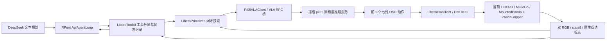

# Panda LIBERO RPent 适配版 20261007 r1

本版使用真实 RPent `ApiAgentLoop → LiberoToolkit → LiberoPrimitives → Pi05VLAClient / LiberoEnvClient → RPC`；环境 RPC 直接使用当前 OpenPI 的定制 LIBERO/robosuite，VLA RPC 桥接冻结 T4 的原精度 PyTorch pi0.5 服务。没有改 RPent、RLinf、控制器或采集/判定源码。



## 新增与复用

- `env_server.py`：BaseEnvFacade + MainThreadServeMixin；20 Hz，官方初态 seed % 初态数，10 步静置。LIBERO 内部标准映射为 MountedPanda。动作校验、最多 5 步的 chunk、220 步预算与原生成功即停，非法输入不会推进物理。
- `vla_bridge.py`：BaseVLAFacade，复用原图像预处理；输入两路 256 RGB 旋转图和 8 维本体状态，pad-resize 224，原服务返回 10×7，桥只返回前 5 步，不改模型/去噪/归一化。
- `run_episode.py`：真实 ApiAgentLoop 和 LiberoToolkit；首轮仅暴露 view_env_state、pi0_pick、pi0_doubled、finish。规划器还会自动提供原生 read_image，但 no_images 模式仅返回省略提示。SAM3 与几何移动工具未接入，不伪造服务。
- `launch.py`、`workflow.py`：宿主入口。完整 workflow 管理模型启动、最多两路 CPU 仿真、真实 DeepSeek 调用、正常关闭和退出证据。
- `audit.py`：独立关联原始预测、限幅后实际动作、逐步时间、原生成功标志、模型身份、finish 与双视角视频帧数。
- `capture.py`：核对冻结 T4 源码，记录 RPent commit、当前模型/控制源码和镜像指纹。

上层文本模型在本基线负责选择 VLA 工具、读取终止反馈和结束任务；视觉操作由 pi0.5 完成。默认使用完整原任务指令反复闭环执行，尚未证明 LLM 分解与恢复比纯 VLA 更好，也未验证完整 RPent CLI / Dashboard 或所有几何工具。该入口不替换标准 RLinf 后端。

## 复现

宿主服务器 Python 3 即可运行启动器；运行环境位于项目独立 `runtime/py310`，容器内使用 Python 3.10.12 / MuJoCo 3.2.6。环境创建时复制旧仿真运行环境，再追加 RPent API/RPC 依赖；实际版本清单位于 `reports/runtime_packages_r1.json`。旧运行环境只读。

在宿主执行（每次改用新的 run-id）：

```bash
cd /mnt/data/vla-policy/openpi/gpt-rpent-control
python3 versions/panda_libero_20261007_r1/workflow.py --run-id spatial10_new --workers 2
docker run --rm --network none \
  -v /mnt/data/vla-policy/openpi/gpt-rpent-control:/control \
  --entrypoint /control/runtime/py310/bin/python libero:latest \
  /control/versions/panda_libero_20261007_r1/audit.py \
  --run /control/runs/spatial10_new --output /control/reports/spatial10_new_audit.json
```

依赖服务器已有 Docker 镜像、冻结原精度模型资产及 `gpt-6-control/deepseek_api_key`。凭据由宿主读取，通过 stdin 交给规划进程，不进入命令行/环境变量；仓库挂载中的旧凭据文件用 `/dev/null` 遮蔽，子进程 stdin 为独立死亡监测管道。

`runs/<run-id>/taskXX_seed0` 保存：实际执行源码、RPent 逐工具状态与图像、官方初态/控制参数、逐步实际动作、全部 VLA 预测和对应输入、DeepSeek 响应模型/usage、工具会话、双视角视频及实际退出码。LLM 的 finish 与原生成功分开统计。失败和开发调试运行保留。

完整 Spatial 10×1 仅为当前工程基线；不能据此声称正式统计 benchmark、实机适配、ECO65 或 ZhiXing 已通过。
